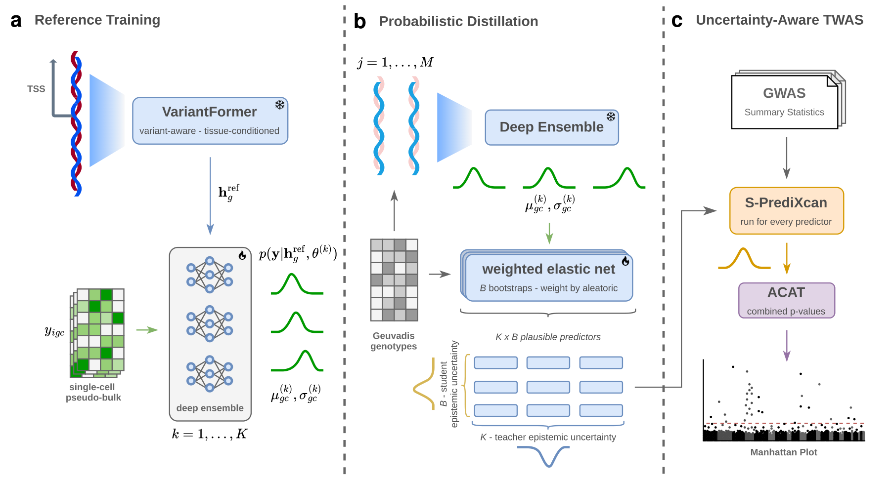

# ATTICUS

[](https://www.python.org/downloads/release/python-3120/)
[](https://docs.astral.sh/uv/)
[](#try-it-out)
[](https://huggingface.co/datasets/Padraig7/atticus-onek1k)
[](https://huggingface.co/Padraig7/atticus-onek1k)
[](https://huggingface.co/datasets/Padraig7/atticus-summary-stats)

**Personalised gene expression prediction and uncertainty-aware TWAS.** 

Welcome! ATTICUS brings together personalised sequence representations and uncertainty-aware expression prediction. By transferring regulatory information from models pretrained on bulk expression, it enables cell-type-specific predictions without requiring genotypes paired with single-cell expression data. It then propagates predictive uncertainty into transcriptome-wide association studies (TWAS), helping prioritise disease-associated genes and cell types.

📄 [Preprint](TBD) · 🚀 [Get Started](README.md#Getting-Started) 

Questions, ideas, or feedback? Looking forward to hear from you! Send us an e-mail, or open an issue :)



*ATTICUS Overview, from Figure 1 of the manuscript.*

## Getting Started

Installing new projects is incredibly annoying, but we'll try to make the whole
process bearable. Good news is that you bascially don't have to leave this repo.
We use [uv](https://docs.astral.sh/uv/getting-started/installation/#installation-methods)
to manage Python **3.12** and its dependencies. It's pretty easy to install:

```bash
curl -LsSf https://astral.sh/uv/install.sh | sh
```

Restart your shell afterward so `uv` is available on your `PATH`.

For data preparation, you'll also need **bcftools ≥1.21** (with the `split`
plugin), **samtools ≥1.21**, **PLINK 2**, and **bedtools** on your `PATH`.
[Bioconda](https://bioconda.github.io/#with-conda) can supply these, plus Git,
Git LFS, and curl:

```bash
conda create -n atticus-tools -c conda-forge -c bioconda --strict-channel-priority \
  'bcftools>=1.21' 'samtools>=1.21' plink2 bedtools git git-lfs curl
conda activate atticus-tools
```

If your cluster's modules already provide these, you're all set. Now grab the repo:

```bash
git lfs install
git clone --recurse-submodules https://github.com/Padraig20/atticus.git
cd atticus
bash setup.sh
uv sync --locked --inexact --extra notebooks --extra training --extra distillation --extra twas
uv run --no-sync python -m ipykernel install --user --name atticus --display-name "Python (ATTICUS)"
```

Setup creates the Python environment and initializes the pinned VariantFormer
and MetaXcan submodules. The next commands install notebook and analysis
dependencies and register the notebook kernel.

## Get the data

The tutorial trains on **OneK1K blood expression**, distills on a **503-person
European genotype reference**, and runs TWAS with the bundled **AD and SLE**
GWAS tables. Here's where each piece comes from:

| Input | How to get it |
| --- | --- |
| OneK1K expression | Place the downloaded, prepared file here:`data/onek1k/expression.h5ad`. [Download here](https://huggingface.co/datasets/Padraig7/atticus-onek1k) |
| Ready-made OneK1K embeddings | Extract under `data/onek1k/embeddings/`, keeping `reference/REFERENCE.npz` and `individuals/<sample>.npz`. [Download here](https://huggingface.co/datasets/Padraig7/atticus-onek1k) |
| Ready-made linear models | Extract the complete model directory, including covariance files, under `models/onek1k/` to skip straight to TWAS. [Download here](https://huggingface.co/Padraig7/atticus-onek1k) |
| Geuvadis/1000G genotypes | `bash setup.sh --geuvadis` downloads and prepares the 503 reference individuals under `data/geuvadis/`. Allow about 27 GB for downloads, plus working space. |
| Generate your own embeddings (optional) | `bash setup.sh --variantformer` installs the model and its core assets. Notebook 01 walks through reference and personalised blood embeddings. |

The expression file is an AnnData `.h5ad`: one row per individual/cell-type pair,
with `obs["individual_id"]` and `obs["cell_type"]`, and Ensembl gene IDs in
`var_names`. Its `X` matrix holds **mean raw counts** across that individual's
cells of each type.
See the [expression format](docs/command_reference.md#expression-file) for details.

## Try it out!

```bash
uv run --no-sync jupyter lab notebooks/01_data_and_embeddings.ipynb
```

Choose the **Python (ATTICUS)** kernel, then follow the notebooks in order:

| Notebook | What you'll do |
| --- | --- |
| [01 · Data and embeddings](notebooks/01_data_and_embeddings.ipynb) | Locate downloaded data and embeddings, then prepare the genotype reference and generate any missing embeddings. |
| [02 · Reference training](notebooks/02_onek1k_reference_training.ipynb) | Reserve evaluation donors, train a five-member ensemble per cell type, and evaluate the selected models. |
| [03 · Distillation](notebooks/03_geuvadis_distillation.ipynb) | Fit genotype models and save their covariance matrices for TWAS. |
| [04 · TWAS](notebooks/04_twas.ipynb) | Call the bundled MetaXcan S-PrediXcan and explore association summaries. |

Start with `EXECUTE = False` to preview commands; switch to `True` when ready to go.
Set `CELL_TYPE` in the first code cell of notebooks 02–04; the demonstration uses **memory B cells**.
Outputs go under `outputs/tutorial/onek1k/<cell-type>/`. This walkthrough uses OneK1K blood
models for both GWASs; ROSMAP data is not publicly available, sorry!

To jump straight to TWAS, use the supplied **`models/onek1k`** (blood, download first).

```bash
uv run --extra twas python src/twas/run.py -m models/onek1k \
  --gwas data/data-for-the-paper/gwas/gwas-sle.tsv.gz \
  -o outputs/twas-onek1k-sle
```

## Citation

If you found this useful, you'd make us very happy by citing us!

```
(coming soon)
```
